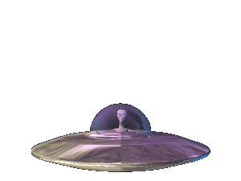
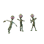

## Hi, I'm Nael! 



<p><em>Solution Engineer at <a href="https://callrounded.com">Rounded</a>, building voice agents <br>
Stanford '26  <br>
Paris, France  </em></p>

[](https://www.linkedin.com/in/nael-ghoundale-412312261/)
[](https://jdid38.github.io/blog/)
[](https://github.com/JDID38?tab=followers)

###  about me...

```python
nael = {
    "based_in": "Paris, France",
    "school": ["Stanford '26", "Arts et Métiers Paris"],
    "work": "voice agents @ Rounded",
    "code": ["Python", "TypeScript", "Julia"],
    "into": ["agent orchestration", "LLMs", "STT", "TTS", "multi-agent RL", "fluid mechanics"],
    "writing": "jdid38.github.io/blog",
}
```

<p> <em><b>Always up for talking</b>, so if you want to say <b>hi, <a href="mailto:nael@callrounded.com">ping me!</a></b></em></p>

<p align="center">
  
</p>

